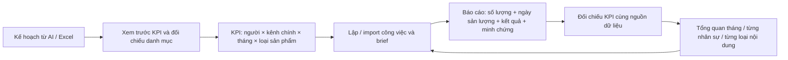

# HacoLED — Thiết kế vận hành sản lượng nội dung

Cập nhật: 28/10/2026. Phạm vi đã thống nhất: sản lượng nội dung. Lead, doanh thu, lượt xem và kết nối API social thuộc giai đoạn sau.

## 1. Luồng dữ liệu thống nhất

- **KPI** là cam kết số lượng trong một kỳ; không phải danh sách công việc.
- **Công việc** là đơn vị phân công/bàn giao. Một việc có thể bàn giao nhiều sản phẩm.
- **Ngày sản lượng** xác định kỳ ghi nhận. **Thời điểm hoàn thành do server lưu** dùng kiểm tra đúng hạn; hai trường phục vụ hai câu hỏi khác nhau.
- **Checklist** là các bước thực hiện; không tự quy đổi thành số bài/video.
- **Minh chứng** là dấu vết bàn giao. Có link không chứng minh nội dung đúng hoặc có chất lượng.
- **Nhiều kênh** trong một việc là phạm vi xuất bản; một KPI vẫn gắn với một kênh chính. Không nhân sản lượng tự động theo số kênh.
- **Ngoài KPI** là việc không gắn chỉ tiêu, không phải việc thuộc một chỉ tiêu đã tạm dừng.

## 2. Quyền và trách nhiệm

| Vị trí | Xem chỉ tiêu/báo cáo | Tạo việc | Giao/sửa/import KPI | Xem mật khẩu kênh |
|---|---|---|---|---|
| Giám đốc, Leader Marketing | Toàn bộ | Cho mọi người | Có | Theo quyền quản trị hiện có |
| Trưởng phòng Marketing | Mình + nhân viên + thực tập | Cho mình | Không | Có, cùng quyền quản lý kênh |
| Nhân viên, thực tập | Của mình | Cho mình | Không | Chỉ khi được cấp theo kênh |
| Kinh doanh | Chưa cấp | Chưa cấp | Không | Chưa cấp |

Quyền được kiểm tra tại API. Chọn kênh hoặc liên kết KPI không cấp thêm quyền xem thông tin đăng nhập, giao việc hay đổi chỉ tiêu.

## 3. Dữ liệu và các bất biến

| Đối tượng | Khóa / dữ liệu chính | Bất biến |
|---|---|---|
| Nhân sự | UUID, email, vai trò, trạng thái | Import dùng email đang hoạt động; không tự tạo tài khoản từ tên AI |
| Kênh | UUID, nền tảng, @định danh, URL, trạng thái | Khi định danh trùng phải dùng UUID/URL hoặc nền tảng để đối chiếu |
| KPI | người, kênh, tháng, loại, target, active, version | Duy nhất người × kênh × tháng × loại; target nguyên dương; không đổi danh tính kỳ sau khi tạo |
| Công việc | người, kênh chính/nhiều kênh, loại, KPI tùy chọn, brief, planned_quantity | KPI phải khớp người, kênh chính và loại sản phẩm |
| Báo cáo kết quả | trạng thái, delivered_quantity, delivered_on, kết quả, ảnh, version | Không nhận chỉ tiêu mới từ báo cáo của thành viên; phiên bản cũ bị từ chối |
| Nhật ký | actor, thời điểm, ảnh chụp giá trị | Giữ lịch sử chỉ tiêu và kết quả; tạm dừng không gỡ việc cũ khỏi KPI |
| Lần import | UUID lần nhập, người nhập, hash nội dung, số dòng | Xác nhận lại cùng lần không tạo thêm dữ liệu; cùng UUID với nội dung khác bị từ chối |

Chưa hoàn thành thì khối lượng dự kiến không đóng góp KPI. Khi xác nhận hoàn thành nhanh mà chưa nhập sản lượng, mặc định ghi nhận khối lượng đã giao; số thực tế được nhập rõ (kể cả 0) được ưu tiên. Không cộng nhiều lần chỉ vì một người gửi lại báo cáo. Không cộng chung bài viết, video, ảnh thành một tỷ lệ hiệu suất tổng hợp chưa có trọng số được duyệt.

## 4. Use-case và tiêu chí nghiệm thu

### UC01 — Chuẩn bị kế hoạch bằng AI

**Người dùng:** Leader/Giám đốc. **Trước khi làm:** danh mục nhân sự và kênh đã có.

1. Tải mẫu CSV và danh mục đối chiếu JSON trong Import KPI.
2. Cung cấp danh mục cho AI; yêu cầu một dòng cho mỗi người × kênh × tháng × loại sản phẩm.
3. Chỉ tiêu chỉ chứa số; nội dung/yêu cầu để trong ghi chú.
4. Đưa CSV UTF-8, bảng sao chép từ Excel (TSV), hoặc JSON vào màn hình import.

**Ngoại lệ:** AI bịa email/kênh, đưa KPI lượt xem/lead/doanh thu, ghi “20 bài” vào ô số. **Nghiệm thu:** báo lỗi đúng dòng; không suy đoán tài khoản, không tự chuyển sang loại “khác”. Excel `.xlsx` cần lưu CSV UTF-8 hoặc sao chép bảng; không đọc trực tiếp file nhị phân XLSX.

### UC02 — Xem trước KPI hàng loạt

1. Chọn Chỉ tạo mới hoặc Tạo mới và cập nhật.
2. Hệ thống đối chiếu danh mục, tháng, loại sản phẩm, số lượng và khóa trùng.
3. Hiện người/kênh đã khớp, chỉ tiêu hiện có → chỉ tiêu mới, lỗi từng dòng và tổng số tạo/cập nhật.

**Nghiệm thu:** bước xem trước không ghi dữ liệu. Một dòng lỗi chặn xác nhận toàn bộ file. Tối đa 500 dòng, 1,5 MB. Tên cột có dấu/alias thông dụng được chuẩn hóa; cột không hỗ trợ phải báo rõ.

### UC03 — Xác nhận và thử lại import KPI

1. Gửi nội dung đã xem trước, dấu kiểm tra danh mục/phiên bản và UUID lần nhập.
2. Server kiểm tra lại quyền, danh mục, mục tiêu hiện có.
3. Ghi cả batch, KPI và nhật ký trong một transaction.

**Ngoại lệ:** người khác sửa chỉ tiêu sau xem trước, nhân sự/kênh bị khóa, mất mạng hoặc hai người nhập cùng khóa. **Nghiệm thu:** không ghi nửa file; xung đột yêu cầu xem trước lại. Nếu lần đầu đã lưu nhưng mất phản hồi, gửi lại cùng UUID trả kết quả đã lưu, không tạo bản sao.

### UC04 — Cập nhật chỉ tiêu tồn tại

**Luồng:** chọn chế độ cập nhật, đối chiếu giá trị cũ/mới rồi xác nhận. **Nghiệm thu:** thay target và ghi chú, giữ UUID, công việc, kết quả và audit. Không cộng dồn target. Không tự bật lại KPI tạm dừng. Việc tăng/giảm target sẽ thay đổi tỷ lệ đạt hiện tại và phải được giải thích bằng audit/ghi chú.

### UC05 — Giao KPI thủ công

Chọn nhân sự đang hoạt động, kênh, tháng, loại sản phẩm, chỉ tiêu và yêu cầu. **Nghiệm thu:** trùng khóa bị từ chối; danh tính kỳ cố định sau tạo. Điều chỉnh target/ghi chú/trạng thái dùng version để tránh ghi đè.

### UC06 — Chuyển mục tiêu thành kế hoạch làm việc

Từ thẻ KPI, mở danh sách hoặc lập việc. Chỉ tiêu được mang theo cùng người, kênh chính, loại sản phẩm; người giao nhập khối lượng dự kiến và brief. **Nghiệm thu:** chưa có việc hoặc tổng dự kiến thấp hơn target xuất hiện ở mục “Từ chỉ tiêu đến kế hoạch làm việc”. Planned không được tính như delivered.

### UC07 — Import kế hoạch công việc gắn KPI

1. Import KPI trước.
2. Dùng mẫu kế hoạch công việc, điền `han_hoan_thanh` theo YYYY-MM-DD.
3. Tự đối chiếu KPI theo email nhân sự, tháng hạn hoàn thành, loại sản phẩm và kênh đầu tiên (kênh chính).
4. Xem trước: mỗi việc báo đã gắn chỉ tiêu hoặc ngoài KPI.
5. Xác nhận sau khi hết lỗi.

**Nghiệm thu:** nhiều kênh chỉ tính KPI của kênh đầu tiên, không nhân sản lượng. Nếu chưa có hạn hoặc không có KPI phù hợp, ghi việc ngoài KPI và thông báo trong bản xem trước. File cũ có `thang_kpi` phải khớp tháng hạn hoàn thành; cột cũ chỉ dùng dự phòng khi chưa có hạn. Deadline ngày trong CSV thống nhất 17:00 Asia/Ho_Chi_Minh như biểu mẫu. Retry cùng batch không nhân công việc. Những dòng mẫu được bỏ qua; dòng dữ liệu lỗi không được cắt/ngầm sửa để nhập.

### UC08 — Brief theo loại nội dung

- Facebook: tuyến nội dung, định dạng, CTA, link website khi có.
- Website: từ khóa chính, slug, liên kết cần trỏ.
- Video dài/ngắn: định hướng nội dung và yêu cầu bàn giao.
- Việc khác: ghi chú việc cần làm và kết quả.

**Nghiệm thu:** giữ cấu trúc brief để lọc/đối chiếu được tuyến, định dạng và từ khóa; không chỉ gộp mọi thứ vào một chuỗi mô tả. Các trường chưa được ghi nhận được hiển thị đúng là thiếu dữ liệu, không chấm điểm chất lượng tự động.

### UC09 — Nhân sự thực hiện và báo cáo

Mở việc của mình, cập nhật checklist, kết quả, số lượng thực tế, ngày sản lượng, trạng thái, ảnh/link. **Nghiệm thu:** chỉ chủ việc hoặc quản trị toàn quyền được báo cáo; chỉ KPI cùng người/kênh/loại mới nhận sản lượng. Số nguyên không âm, ngày hợp lệ không nằm trong tương lai. Ảnh xem trong màn hình; lỗi tải ảnh không mất URL.

### UC10 — Một việc bàn giao nhiều sản phẩm

Ví dụ một việc bàn giao 3 bài. **Nghiệm thu:** báo cáo hiển thị 1 công việc, 3 bài; KPI tăng 3 bài khi hoàn thành. Không tăng theo số checklist hoặc số kênh phụ. Công việc hoàn thành nhưng sản lượng 0 không tạo sản lượng giả.

### UC11 — Sửa kết quả, mở lại việc và thay đổi liên kết

Gửi lại số thực tế cập nhật một hàng hiện tại và thêm nhật ký; mở lại loại đóng góp cho đến khi hoàn thành lại. **Nghiệm thu:** không cộng trùng lịch sử báo cáo; version cũ bị từ chối; đổi người/kênh/loại phải gỡ hoặc chọn KPI phù hợp. Ngày sản lượng là dữ liệu tự khai, không thay thế thời điểm server để chấm đúng hạn.

### UC12 — Đạt, vượt và lệch kỳ

Ví dụ 22/20 bài = 110%, vượt 2 bài. Sản lượng làm sớm/trễ hiện riêng và vẫn cộng vào tháng KPI đã giao; ngày sản lượng thực tế được giữ nguyên. **Nghiệm thu:** phần trăm không bị cắt ở 100%; thanh tiến độ có thể dừng ở 100% nhưng số vượt vẫn rõ. Đổi trạng thái chưa hoàn thành không làm tăng kết quả.

### UC13 — Công việc ngoài KPI

Nhân sự ghi nhận hỗ trợ/phát sinh cho mình; không chọn KPI. **Nghiệm thu:** có danh sách việc ngoài KPI và các loại sản lượng riêng. Không cộng 2 ảnh + 1 bài thành “3 bài”. KPI tạm dừng vẫn giữ việc thuộc KPI, không tự chuyển thành ngoài chỉ tiêu.

### UC14 — Tạm dừng/khôi phục KPI

Leader/Giám đốc tạm dừng một KPI. **Nghiệm thu:** giữ liên kết, target history, kết quả và audit. Không gắn việc mới vào KPI tạm dừng; việc cũ vẫn đọc/báo cáo theo quy tắc hiện có. Xem KPI tạm dừng bằng bộ lọc và khôi phục qua chỉnh sửa. Tạm dừng dùng PATCH active=false. DELETE thực hiện xóa chỉ tiêu và chuyển công việc liên kết ra ngoài KPI, giữ ảnh chụp nhật ký.

### UC15 — Tổng quan theo tháng

Chọn tháng để xem việc đến hạn, hoàn thành, quá hạn chưa xong, tỷ lệ đúng hạn đủ dữ liệu, KPI đạt/vượt và việc phát sinh. **Nghiệm thu:** KPI tháng và Tổng quan lấy cùng hàm dữ liệu KPI, không có hai công thức khác nhau. Biểu đồ 6 tháng dùng số công việc, không gộp sản lượng khác đơn vị vào cùng cột.

### UC16 — Theo dõi phát triển của nhân sự

Xem từng người qua hai tháng: số việc hoàn thành, hoàn thành nhóm đến hạn, tỷ lệ đúng hạn, KPI đạt/giao, số KPI vượt, việc ngoài chỉ tiêu và dấu vết bàn giao. Mở chi tiết để đi tới công việc gốc. **Nghiệm thu:** cùng người, cùng loại chỉ số; thay đổi tỷ lệ ghi theo điểm phần trăm, tăng trưởng sản lượng theo %. Nền 0/thiếu dữ liệu trả N/A, không tự tính 100%. Tháng đang diễn ra được cảnh báo không so trực tiếp như một tháng đã hoàn tất.

### UC17 — Rà soát theo trường chi tiết

Phân rã sản lượng theo người, kênh chính, loại sản phẩm và tuyến nội dung; xem định dạng, từ khóa, có kết quả/minh chứng và checklist. **Nghiệm thu:** đếm việc riêng với đơn vị sản lượng; nhãn “chưa ghi” rõ ràng. Có minh chứng không đồng nghĩa đã duyệt; không tự đánh giá năng lực từ độ dài mô tả hoặc số link.

### UC18 — Lọc quyền báo cáo

Nhân viên/thực tập chỉ xem mình; Trưởng phòng xem mình + nhân viên/thực tập; Leader/Giám đốc xem toàn bộ. **Nghiệm thu:** API báo cáo áp dụng scope trong SQL trước tổng hợp, không chỉ ẩn hàng trên UI. Kinh doanh chưa cấp quyền bị chặn; import chỉ toàn quyền. API không trả mật khẩu, hash hoặc ciphertext kênh.

### UC19 — Thiếu dữ liệu và tháng trống

Không có việc đến hạn: tỷ lệ hoàn thành = N/A. Không có thời điểm hoàn thành đủ để kiểm tra: tỷ lệ đúng hạn = N/A. Không có sản lượng tháng trước: tăng trưởng = N/A. **Nghiệm thu:** không biến thiếu dữ liệu thành 0 điểm, không xếp hạng người bằng mẫu số khác nhau mà thiếu cảnh báo.

### UC20 — Đối chiếu và thay đổi lịch sử

Mỗi con số có đường về KPI/công việc/kỳ. Dữ liệu hiện tại có thể được sửa hoặc mở lại, nên báo cáo quá khứ có thể đổi. **Nghiệm thu hiện tại:** ghi rõ “chưa chốt kỳ”, giữ nhật ký và batch import. **Giai đoạn sau:** bổ sung chốt kỳ/ảnh chụp bất biến và quy trình mở khóa có quyền trước khi dùng báo cáo làm căn cứ lương/thưởng.

## 5. Định nghĩa chỉ số

| Chỉ số | Tử số / tập dữ liệu | Mẫu số / giới hạn |
|---|---|---|
| Sản lượng KPI tháng | SUM delivered_quantity của việc hiện tại đã completed, khớp KPI/người/kênh chính/loại; kỳ ghi nhận là tháng KPI được giao, không lọc theo delivered_on | target nguyên dương; không SUM bảng lịch sử |
| % đạt KPI | sản lượng KPI / target × 100 | không cộng các đơn vị khác loại; không cắt phần vượt |
| Công việc đến hạn | due_at theo ngày Việt Nam trong tháng chọn | không đồng nhất với việc được tạo hoặc hoàn thành trong tháng |
| Tỷ lệ hoàn thành nhóm đến hạn | số việc trong nhóm đến hạn có trạng thái completed hiện tại | tổng việc trong nhóm đến hạn; không có nhóm trả N/A |
| Việc hoàn thành trong tháng | completed hiện tại, delivered_on trong tháng; fallback ngày completed_at nếu chưa có delivered_on | có thể không cùng nhóm đến hạn; phản ánh trạng thái hiện tại |
| % đúng hạn | việc thuộc nhóm đến hạn đã completed, có completed_at và completed_at ≤ due_at | chỉ việc trong nhóm đến hạn đã completed và có completed_at; thiếu thời điểm không phán đoán |
| Việc quá hạn chưa xong | việc trong nhóm đến hạn còn mở và due_at đã qua tại lúc xem | không tái dựng trạng thái cuối tháng trong quá khứ |
| Tăng trưởng sản lượng | (tháng chọn − tháng trước) / tháng trước | cùng loại sản phẩm, nền 0 trả N/A; tháng hiện tại là kỳ chưa đủ |
| Chênh lệch tỷ lệ | tỷ lệ tháng chọn − tỷ lệ tháng trước | điểm phần trăm; một bên N/A thì N/A |
| Có kết quả/minh chứng | số việc completed trong kỳ có text / ít nhất một URL | đo dấu vết hiện diện, chưa xác minh link, chất lượng hay đã xuất bản |

## 6. Ranh giới đã triển khai và phần sau

**Hiện tại:** import KPI/việc có xem trước và retry, đối chiếu danh mục, giữ audit khi tạm dừng, liên kết kế hoạch với KPI, báo cáo tháng/từng người/tuyến/định dạng/từ khóa, phân quyền phía server, CSV/TSV/JSON cho KPI, CSV cho kế hoạch công việc.

**Chưa tuyên bố có:** đọc XLSX nhị phân trực tiếp; xác minh bài đăng duy nhất qua API social; tự phát hiện hai công việc báo cùng một bài; duyệt chất lượng có trọng số; bảng điểm năng lực tổng hợp; lead/doanh thu; chốt kỳ bất biến; tích hợp lương/thưởng. Các phần này cần định nghĩa nghiệp vụ và nguồn dữ liệu trước khi thêm điểm đánh giá.

### Thiết kế sẵn cho giai đoạn API social

Khi kết nối API, thêm thực thể publication có platform_post_id duy nhất theo nền tảng/kênh, liên kết publication ↔ content_asset ↔ task để chống đếm trùng. Lưu metric snapshots theo thời điểm và đơn vị (view, click, inquiry, revenue), nguồn/độ trễ/quyền token, rồi xây KPI kết quả riêng với KPI sản lượng. Không ghi đè kết quả tự báo cáo bằng số API thiếu mẫu số hoặc ngoài cửa sổ thời gian. Credentials hiện tại vẫn tách khỏi metadata/report APIs.

## 7. Kiểm thử / triển khai

- `tests/bulk-performance.spec.ts`: parsing dữ liệu AI/Excel, preview lỗi, xung đột phiên bản, retry cùng UUID, import việc nối KPI, phân quyền báo cáo, tăng trưởng theo loại, N/A, tạm dừng giữ liên kết; desktop/mobile.
- Bộ kiểm thử tài khoản, vai trò, task reporting, kênh và KPI tiếp tục bảo vệ các use-case hiện có.
- `010-kpi-imports.sql` thêm bảng batch/audit import, không sửa sản lượng cũ.
- Production chạy migration theo pipeline hiện tại. Kiểm thử local dùng PGlite/dummy Neon, không ghi database hoặc Blob production.

Cập nhật luồng công việc: KPI được tự đối chiếu theo người × kênh chính (kênh đầu tiên) × loại sản phẩm × tháng của hạn hoàn thành, theo múi giờ Việt Nam. Biểu mẫu hiển thị chỉ tiêu chỉ đọc, không cần tích hoặc chọn tháng. Tạo/sửa công việc có hạn được server đối chiếu lại; không tự cập nhật hàng loạt việc cũ nếu chưa lưu sửa. Nếu chưa có hạn hoặc chỉ tiêu phù hợp, biểu mẫu ghi rõ ngoài KPI. Mẫu CSV mới bỏ `thang_kpi` và `do_uu_tien`; file cũ vẫn nhận, nhưng tháng KPI cũ khác hạn hoàn thành sẽ báo lỗi. Độ ưu tiên được bỏ khỏi giao diện công việc; dữ liệu cũ vẫn giữ. Bảng, Kanban và to-do đều xếp hạn tăng dần, việc chưa có hạn xuống cuối trong từng nhóm trạng thái.

### Nghiệm thu hoàn thành và ghi nhận KPI

- Tích hoàn thành từ to-do, chuyển Kanban, sửa trạng thái, tạo/import việc đã hoàn thành: nếu không nhập sản lượng riêng, lấy khối lượng đã giao. Đã có số thực tế dương thì giữ số đó; không tự tăng khi gửi lại.
- Báo cáo chi tiết tự điền khối lượng khi chuyển sang hoàn thành nếu người dùng chưa sửa số. Nhập rõ 0 nghĩa là không có sản lượng; cập nhật lại việc đã hoàn thành không tự đổi 0 thành số dự kiến.
- Mở lại việc loại sản lượng khỏi KPI; hoàn thành lại lấy số hiện tại, không cộng dồn lịch sử. Sửa báo cáo thay số cũ.
- Giao KPI tháng 11, hoàn thành thực tế tháng 10 hoặc tháng 12: đều tính vào mục tiêu tháng 11 đã giao. Báo cáo sản lượng thực tế tháng 10/12 vẫn dùng ngày thực tế; các tập dữ liệu có mục đích khác nhau.
- Việc cũ hoàn thành với số 0 được cảnh báo trên thẻ KPI và biểu mẫu kết quả. Nút dùng khối lượng đã giao cần người dùng xác nhận bằng thao tác lưu; không sửa hàng loạt số liệu cũ.
- Kiểm thử `completion-kpi.spec.ts` tái hiện UI to-do, UI báo cáo nhân viên, API tạo/sửa, import/retry, sửa sản lượng, 0 tường minh, mở lại và hoàn thành sớm khác tháng.

### Xóa KPI/công việc tạo lỗi

Leader Marketing và Giám đốc có quyền xóa; Trưởng phòng, nhân viên, thực tập và kinh doanh không có quyền này. Nút xóa có ở thẻ KPI, bảng/Kanban/to-do và chi tiết công việc; hủy xác nhận không ghi dữ liệu.

Xóa KPI thực hiện trong một transaction: khóa phiên bản chỉ tiêu, lưu snapshot chỉ tiêu và lịch sử điều chỉnh vào `app_deletion_audit`, gỡ liên kết KPI trên công việc và tăng report_version, sau đó xóa chỉ tiêu. Công việc, sản lượng thực tế, ngày và lịch sử báo cáo còn nguyên; có thể tạo lại chỉ tiêu đúng cùng khóa người/kênh/tháng/loại với UUID mới. Tạm dừng/khôi phục vẫn có qua phần chỉnh sửa.

Xóa công việc lưu snapshot và danh sách kênh vào nhật ký trước khi xóa. Sản lượng hiện tại của việc đó không còn đóng góp KPI; lịch sử báo cáo cũ vẫn giữ. Chưa có luồng khôi phục từ giao diện. Migration `011-deletion-audit.sql` tạo bảng nhật ký, không tự xóa bất kỳ dữ liệu sẵn có nào.
